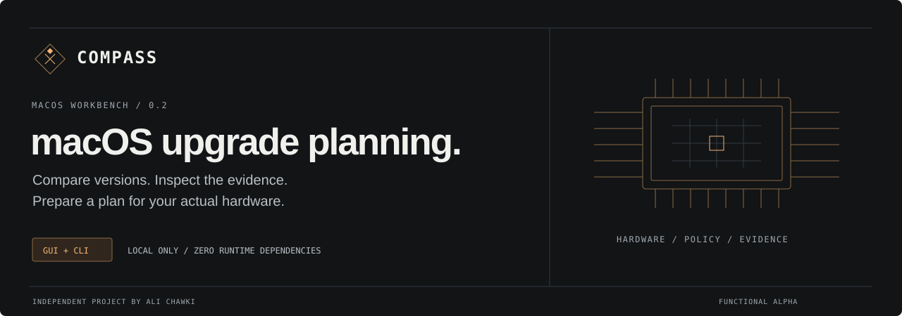

<div align="center">



**macOS upgrade decisions for Intel Macs.**

Hardware-aware recommendations, source-linked owner reports, and a local workbench for comparing the tradeoffs.

`Python 3.10+` · `Zero runtime dependencies` · `GUI + CLI` · `MIT`

</div>

Compass compares macOS versions against a reviewed model policy, your hardware configuration, and the essential applications you specify. It explains why a version ranks well, which requirements exclude another, and what still needs checking before installation.

It runs locally, without an account or administrator privileges. The browser interface and terminal commands use the same recommendation engine. No telemetry, automatic downloads, or system modifications.

> **Functional alpha.** The bundled evidence corpus contains **two reviewed owner reports**, covering two exact models. The current ranking relies mainly on documented compatibility and explicitly labeled heuristics, not broad community consensus or measured performance. Automatic hardware detection still needs live Intel-Mac validation. See [the validation record](docs/VALIDATION.md).

## Start

Install Python 3.10 or newer, extract the repository, and open Terminal in the project directory:

```bash
python3 -m compass gui
```

On macOS, you can also double-click `Launch.command`. Keep Terminal open while using the interface; press Control-C to stop the session. If automatic drive-type detection returns “unknown,” verify the drive and select its type in Hardware lab.

Try the interface on another platform without pretending to scan a Mac:

```bash
python3 -m compass gui --demo
```

Optional installation:

```bash
python3 -m venv .venv
source .venv/bin/activate
python -m pip install .
oclp-compass gui
```

## Workbench

| Workspace | What it does |
| --- | --- |
| Recommendation | Shows the best eligible fit, native/OCLP route, stock graphics-patch expectation, and evidence count. Filter and sort the full version table. |
| Compare versions | Compares two targets, with signed preference-score differences and plain-language installation/patching tradeoffs. |
| Upgrade plan | Builds a target-specific preparation checklist. Distinguishes upgrades, same-major choices, and downgrades. Excluded targets receive preparation guidance only. |
| Hardware lab | Displays inventory, searches 52 reviewed model policies, imports/exports profiles, and simulates memory/drive changes without replacing the active profile. |
| Owner reports | Filters exact-model reports by outcome, OS, summary, version, and author. Shows missing information and links to original sources. |
| Method & sources | Explains every score and assumption, displays policy age, and links primary references. |

The interface uses 16 px base text with an 18 px option, high-contrast dark and light modes, keyboard focus styles, labeled controls, and a command palette (`Command-K` / `Control-K`). Preferences and device data remain in memory for the session; nothing is saved automatically in browser storage.

More on the controls and their limitations: [workbench guide](docs/WORKBENCH.md).

## What the engine checks

- Explicitly reviewed Intel model and known CPU architecture.
- Native versus OCLP route and stock graphics-patch expectations.
- Minimum OS, RAM constraints, and prerelease exclusions.
- User-declared essential-app requirements: major macOS version, AVX2, and Metal.
- Storage, RAM, OS-overhead, graphics-patch, and maintenance assumptions.
- Exact-model community evidence, independent-author deduplication, age/configuration weighting, conflicts, and bounded influence.

The catalog includes selected 2011–2017 MacBook Pro, MacBook Air, MacBook, Mac mini, and iMac identifiers. Run `python3 -m compass models` for the exact list. Unreviewed models, including configurable Mac Pros, receive no installation recommendation; this does **not** establish that OCLP cannot support them. Apple Silicon receives native-upgrade guidance.

Tahoe is visible but excluded because the **2026-11-08** upstream snapshot marked its OCLP 3.0.0-rc.5 support as prerelease. This is a dated policy, not a live support promise. Check [upstream releases](https://github.com/dortania/OpenCore-Legacy-Patcher/releases) before acting.

## Terminal commands

```bash
# Export a sanitized, reusable hardware profile.
python3 -m compass detect --json > my-mac.json

# Rank this Mac using your selected priority.
python3 -m compass recommend --priority balanced

# Compare Monterey with Sequoia on the example hardware.
python3 -m compass compare --demo --left 12 --right 15

# Get a target-specific preparation plan.
python3 -m compass plan --demo --target 15

# Estimate how different RAM / storage assumptions affect fit scores.
python3 -m compass simulate --demo --ram 8 --drive hdd

# Produce a readable report or machine-readable analysis.
python3 -m compass recommend --demo --format markdown > analysis.md
python3 -m compass recommend --profile my-mac.json --json > analysis.json

# Apply vendor-checked requirements and a reviewed evidence corpus.
python3 -m compass gui --requirements examples/requirements.json
python3 -m compass validate-evidence reports.json
python3 -m compass gui --reports reports.json
```

`examples/requirements.json` describes an **invented example app**, not a vendor support claim. Replace it before making decisions. GUI **Save profile** exports a reusable hardware profile; **JSON analysis** exports the entire recommendation. Those are different formats. CLI imports accept at most 2 MB; browser profile imports are limited to 12 KiB and sent only to the authenticated local server.

Exit codes: `0` success, `2` invalid input / detection / IO failure, `3` no eligible recommendation, comparison winner, or plan target. A successful plan command does not mean the checklist is complete or installation is safe.

## What a score means

Scores are preference indexes, not measured speed, probabilities of success, battery life, or frame rates. The engine uses hand-authored priors and penalties; those coefficients have not been calibrated against measurements.

| Priority | Smoothness estimate | OS recency | Maintenance ease |
| --- | ---: | ---: | ---: |
| Balanced | 45% | 35% | 20% |
| Smoothness | 75% | 10% | 15% |
| Newer apps | 20% | 65% | 15% |

“OS recency” expresses a preference for newer releases. It is not an application catalog or a statement about current security-update coverage. App constraints currently cover major OS versions and coarse AVX2/Metal requirements; minor/build minimums, Metal feature families, DRM, peripherals, and actual app behavior need separate verification.

Simulations show the model's sensitivity, not benchmark gains or physical upgradeability. RAM may be soldered, and drives can have model-specific restrictions. Changing hardware or app constraints invalidates plan confirmations. A checked box records your assertion; Compass cannot verify your backup or recovery method.

See [architecture and formulas](docs/ARCHITECTURE.md), [evidence review](docs/EVIDENCE.md), and [security boundaries](SECURITY.md).

## Development

The runtime needs only Python's standard library. Node packages are optional development/test tools.

```bash
python3 -m unittest discover -v
python3 -m compass validate-evidence compass/data/reports.json
python3 -m pip wheel --no-deps .

# Browser workflow and accessibility checks.
npm ci
npx playwright install chromium
npm run test:ui

# Formatting.
python3 -m pip install -r requirements-dev.txt
python3 -m black --check compass tests
npm run format:check
```

The build was checked with **78 Python tests** and a real Chromium workflow covering comparisons, plans, confirmations, simulations, imports, filters, downloads, command navigation, and all six mobile workspaces. The [validation record](docs/VALIDATION.md) distinguishes those results from unperformed Safari and physical-Mac checks. CI configuration is included; no remote CI run is claimed before you push this repository.

## Publish to GitHub

Create an empty repository named `oclp-compass`, then run these commands from this extracted folder:

```bash
git init -b main
git add .
git commit -m "Add OCLP Compass workbench"
git remote add origin https://github.com/YOUR_USERNAME/oclp-compass.git
git push -u origin main
```

Replace `YOUR_USERNAME`. Suggested repository description: “Local-first macOS upgrade planning for Intel Macs, with explainable OCLP recommendations, community evidence, a GUI and a CLI.” Suggested topics: `macos`, `oclp`, `opencore-legacy-patcher`, `hardware-detection`, `python`, `privacy`.

Before a stable release, complete live Intel-Mac testing, independent policy review, and security review. This project never installs macOS, builds OpenCore, patches system volumes, or changes security settings.

Contributions: [CONTRIBUTING.md](CONTRIBUTING.md). Release notes: [CHANGELOG.md](CHANGELOG.md). License: [MIT](LICENSE). Source attribution: [THIRD_PARTY_NOTICES.md](THIRD_PARTY_NOTICES.md).
